<!-- Profile README for github.com/cnafateh -->

  <picture>
    <source media="(max-width: 640px)" srcset="./assets/profile-hero-mobile.svg">
    
  </picture>

  
  &nbsp;
  
  &nbsp;
  

### About

I'm a backend developer working with **C# / ASP.NET Core** and **Python / Django**. I like building APIs, but I care just as much about what happens after the code leaves my machine: database design, authentication, real-time communication, CI, Linux, reverse proxies, and deployment.

I came to software engineering through ISP technical support and robotics teaching. Both taught me to trace problems through the whole system instead of guessing at the visible symptom.

### What I work with

**Application development**

**Data & infrastructure**

### Selected work

<table>
  <tr>
    <td width="50%" valign="top">
      <h3><a href="https://github.com/cnafateh/PrivateReal-timeChatPlatform">Private Real-Time Chat</a></h3>
      
Authenticated messaging over WebSockets, persistent conversations, and a Dockerized Django Channels deployment behind a reverse proxy.

      
<code>Django</code> <code>Channels</code> <code>WebSockets</code>

      
<a href="https://github.com/cnafateh/PrivateReal-timeChatPlatform">Source</a> · <a href="https://chat.sinafateh.ir">Live app</a>

    </td>
    <td width="50%" valign="top">
      <h3><a href="https://github.com/cnafateh/CommerceFlow-API">CommerceFlow API</a></h3>
      
E-commerce backend covering authentication, catalog, checkout, background jobs, caching, automated tests, and containerized delivery.

      
<code>DRF</code> <code>PostgreSQL</code> <code>Redis</code> <code>Celery</code>

      
<a href="https://github.com/cnafateh/CommerceFlow-API">Source</a>

    </td>
  </tr>
  <tr>
    <td width="50%" valign="top">
      <h3><a href="https://github.com/cnafateh/telegram-archive-viewer">Telegram Archive Viewer</a></h3>
      
A self-hosted archive browser with full-text search, filters, and media browsing for exported Telegram conversations.

      
<code>FastAPI</code> <code>SQLite FTS5</code> <code>Docker</code>

      
<a href="https://github.com/cnafateh/telegram-archive-viewer">Source</a>

    </td>
    <td width="50%" valign="top">
      <h3><a href="https://dr-noohi.ir">Medisite</a></h3>
      
A deployed pediatric clinic platform with appointment scheduling, patient accounts, role-based access, and an editorial workflow.

      
<code>DRF</code> <code>JWT</code> <code>RBAC</code> <code>Docker</code>

      
<a href="https://dr-noohi.ir">Live site</a>

    </td>
  </tr>
</table>

  
<b>Other things I've built</b>

  

    <a href="https://github.com/cnafateh/resume-platform">Resume as Code</a> — an Astro-based portfolio and CV from structured content. 
    <a href="https://github.com/cnafateh/digispark-upload-lab">Digispark Upload Lab</a> — USB HID experiments and a Dockerized FastAPI uploader.
  

### Current focus

- Building maintainable **ASP.NET Core** applications with clear service boundaries, EF Core, validation, and dependency injection.
- Improving the **delivery and operations** of the services I self-host: Docker, Linux, HTTPS, CI/CD, backups, and troubleshooting.
- Keeping the architecture practical: enough structure to make changes safe, without adding layers just for the diagram.

---

  <a href="https://sinafateh.ir">Portfolio</a> &nbsp;·&nbsp;
  <a href="https://www.linkedin.com/in/cnafateh/">LinkedIn</a> &nbsp;·&nbsp;
  <a href="mailto:sinafateh1382@gmail.com">Email</a>

Built around real projects, not a wall of widgets.

